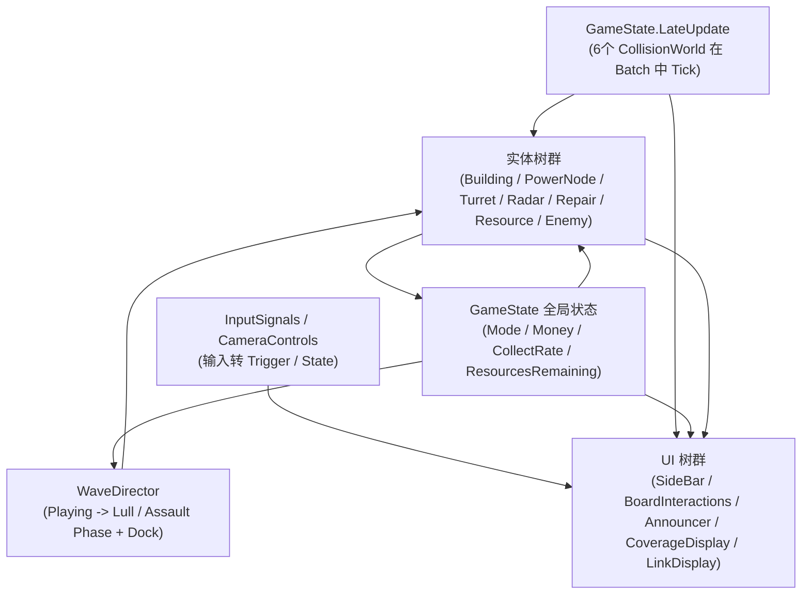
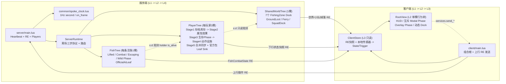

# Spoke 游戏架构调研与本仓架构方案

本文对比 `Adam4lexander/Spoke` 的 `Examples/05_BaseDefence` 范例与 `se-fish` 当前代码结构，总结 Spoke 游戏架构的核心模式，并给出本仓的架构全景与演进路线。

## 调研范围与数据口径

- 上游范例来自 `Adam4lexander/Spoke` 仓库 `main` 分支的 `Examples/05_BaseDefence`，共 29 个源码与文档文件。
- 本仓统计口径排除 `packages/` 与 `_trigger/`，共 126 个业务 Lua 文件，总计 33788 行。其中 `server/` 有 47 个文件 19375 行，`client/` 有 38 个文件 8657 行，`common/` 有 41 个文件 5756 行。
- 复现本仓行数统计的命令如下。

```powershell
python -c "import os, glob; [print(d, len(fs), sum(len(open(p, encoding='utf-8', errors='replace').readlines()) for p in fs)) for d in ['server','client','common'] for fs in [[p for p in glob.glob(os.path.join(d,'**','*.lua'), recursive=True) if os.sep+'packages'+os.sep not in p and os.sep+'_trigger'+os.sep not in p]]]"
```

## 05_BaseDefence 的 Spoke 游戏架构

`05_BaseDefence` 用 Spoke 的响应式作用域树取代了全部 `MonoBehaviour` 生命周期回调。每个实体和系统各自声明一棵状态与生命周期树，条件满足时自动挂载行为，条件失效时逆序清理资源。

### 核心模式

1. **组件即独立 Spoke 树**
   所有玩法实体（`Building`、`PowerNode`、`Turret`、`Repair`、`Radar`、`Resource`、`Enemy`、`Health`、`BombBlast`）和全局单例（`GameState`、`WaveDirector`、`Pool`、`InputSignals`）都继承自 `SpokeBehaviour` 或 `SpokeSingleton`，在 `Init(EffectBuilder s)` 中声明全部因果关系。

2. **用嵌套 `Phase` 表达状态机与资源所有权**
   实体不写分散的 `if (isDead) return` 守卫，而是用嵌套 `s.Phase(condition, block)` 划分生命阶段。`Building.cs` 在 `IsEnabled` 相位内分叉 `health.IsAlive` 与 `isDead` 两个子相位。存活相位负责注册地面碰撞体、加入 `Building.All`、订阅受击闪烁。离开存活相位时 `OnCleanup` 自动注销碰撞体和列表项。进入死亡相位后播放破碎效果，破碎完成后回收到对象池。`Health.cs` 在 `IsEnabled` 的 `OnCleanup` 中把伤害重置为 0，确保对象池复用不带脏状态。

3. **领域数据结构本身输出响应式信号**
   `CollisionWorld<T>` 把二维圆形空间查询封装为 Spoke 信号。实体在活跃相位内通过 `s.Use(GameState.EnemyZone.AddSensor(...))` 或 `AddCollider(...)` 注册空间体，离开相位时自动调用 `Dispose()` 移出网格。`GameState.LateUpdate()` 每帧在 `SpokeRuntime.Batch` 内驱动 6 个 `CollisionWorld.Tick()`，只对脏格子的碰撞体重新计算并更新按距离排序的 `Overlaps` 信号。下游通过 `s.D(sensor.Overlaps)` 响应邻近变化。

4. **分布式响应式网络取代中央调度器**
   电网（`PowerNode.cs`）没有集中式图搜索管理器。每个节点注册自己的接收器与提供器，通过 `s.Memo` 沿 `s.D(n.parent)` 向上追溯祖先集合并判断是否连通 `Core`，对范围内未供电或更远节点按距离抢占。任何中继节点摧毁后，依赖链路沿信号自动断电并重连。

5. **组合式 `EffectBlock` 与作用域绑定的临时视觉节点**
   `Turret`、`Enemy`、`Repair`、`SideBar` 把每个子行为拆成独立 `EffectBlock`，例如 `RotateToTarget`、`IdleBehaviour`、`AttackBehaviour(target)`。`CoverageDisplay.Draw` 与 `LinkDisplay.Draw` 采用无状态静态工厂，每次进入作用域新建临时 `GameObject`、`Mesh` 与 `Material`，退出时通过 `OnCleanup` 销毁。

6. **用 `Dock` 管理动态身份，用受守卫的协程承载短寿命帧循环**
   `WaveDirector.Assault` 使用 `s.Dock()` 为每个生成的敌人挂载一次性死亡计数 `dock.Effect(enemy, ...)`，死亡时调用 `dock.Drop(enemy)`。`Announcer` 用固定键 `"announce"` 覆盖旧播报，自动停止上一条未结束的协程。`SpokeExtensions.cs` 把每帧逻辑封装为受 `IsEnabled` 守卫的 `s.Coroutine(...)`，离开相位自动停止协程。

### 运行时数据流



### 不能直接照搬到本仓的边界差异

- **单机内存直读与多人服务端权威不同**
  `05_BaseDefence` 运行在单机 Unity 进程中，UI 直接读取 `enemy.IsTracked` 并直接修改 `GameState.Money`。本仓运行在蛋仔 SE 状态同步架构下，客户端与服务端跨网络隔离，所有写入必须经 `RemoteEvent` 校验，下行状态必须走快照投影。
- **对象池复用与 SE 销毁语义不同**
  根据 [docs/adr/0022-introduce-spoke-runtime.md](docs/adr/0022-introduce-spoke-runtime.md)，`spoke_eggy.behaviour` 绑定到 `Unit.Destroying`，不覆盖关局事件，也没有 Unity 的 `SetActive(false/true)` 池化复用语义。
- **多人并发写入需要显式事务边界**
  单机下的分布式 `State.Update` 无需处理并发防刷与异步落盘，多人服务端必须收口到 `SpokeRuntime.batch` 与持久化排空栅栏。

## 本仓架构全景

本仓保留 `client/`、`server/`、`common/` 三个运行端目录，采用 [docs/architecture.md](docs/architecture.md) 与 [tools/arch_policy.lua](tools/arch_policy.lua) 强制约束的六层单向依赖架构。

### 六层模块分布

| 层级 | 真实命名空间 | 职责 |
|---|---|---|
| L1 入口 | [server/main.lua](server/main.lua)、[client/main.lua](client/main.lua) | 唯一组合根，装配宿主服务、绑定 `RemoteEvent`、泵入 `SpokeClock`、挂载 `RootView` |
| L2 应用流程与宿主 | [server/world_host/](server/world_host/server_runtime.lua)、[client/views/](client/views/root_view.lua)、`server.ability_api`、`server.ability_behaviors`、`server.player_data_host`、`server.save_host`、`server.platform_host`、`server.fish_ability` | 服务端三类 Spoke 树与持久化、平台、能力宿主；客户端 Spoke 视图树与交互流程 |
| L3 展示与运行端支撑 | [client/store/client_store.lua](client/store/client_store.lua)、`client.game_ui`、`server.fish_behaviors`、`common.re_util`、`common.engine_read`、`common.util` | 客户端只读响应式状态仓库、展示基元、行为分发、引擎读取与协议适配 |
| L4 共享规则与业务状态 | [common/spoke_clock.lua](common/spoke_clock.lua)、[common/game_cfg.lua](common/game_cfg.lua)、`server.data`、`server.swing_registry`、`common.vitals`、`common.attr_model`、`common.fish_catch` 等 27 个规则模块 | 确定性时钟、存档模型、挥砍登记、配置解析与无引擎依赖的共享玩法计算 |
| L5 配置内容 | `common.cfg.*` | 鱼种、道具、商店、抽奖、盲盒、Boss 招式与占位资产数据表 |
| L6 包 | `common/packages/spoke`、`common/packages/spoke_eggy` 及三端官方包 | 整包交付的外部库，禁止反向依赖业务代码 |

### 运行时 Spoke 树拓扑

本仓依照 [docs/adr/0032-spoke-native-lifecycle-architecture.md](docs/adr/0032-spoke-native-lifecycle-architecture.md) 划分服务端三类隔离树与客户端单棵根视图树。



## 对照 05_BaseDefence 的 4 处结构缺口

1. **`ServerRuntime` 维护了过多的外置会话表与手动帧遍历**
   [server/world_host/server_runtime.lua](server/world_host/server_runtime.lua) 共 1319 行。它在树外维护了 7 张按 `user_id` 索引的平行会话表（`weapon_sessions`、`grill_handles`、`shop_handles`、`fisherman_handles`、`lottery_sessions`、`blindbox_sessions`、`platform_shop_sessions`），并在 `step(dt)` 中手动遍历 `weapon_sessions`、`blindbox_sessions`、`platform_shop_sessions` 调用 `.step()`。

2. **`FishTree` 仍是命令式大状态机**
   [server/world_host/fish_tree.lua](server/world_host/fish_tree.lua) 共 2586 行。尽管它为每条鱼创建了 `SpokeTree` 并划分了 `LiftedPhase`、`CombatPhase`、`EscapingPhase`、`WildPhase`，但 4 个相位都订阅 `on_frame` 调用同一个 `host:update_fish(fish, now)`，再由 `if/elseif` 分发 `await_lift`、`wild`、`escaping`、`flying`、`combat`。招式、预警、抓取载体等状态仍散落在裸表 `fish` 字段上。

3. **`PlayerTree` 与 `ServerRuntime` 存在双向句柄耦合**
   [server/world_host/player_tree.lua](server/world_host/player_tree.lua) 共 1080 行。`ServerRuntime` 在 `PlayerTree.spawn` 之后通过 `player_tree:mount_phase("alive", ...)` 挂载 5 个子模块（`weapon`、`grill`、`shop`、`fisherman`、`lottery`），又把子模块返回的句柄存回 `ServerRuntime` 局部表供 `RemoteEvent` 路由调用。追踪一次玩家操作需要跨越 `server/main.lua`、`server_runtime.lua`、`player_tree.lua` 和具体子模块 4 个文件。

4. **`client/main.lua` 顶层持有跨 HUD 局部交互状态**
   [client/main.lua](client/main.lua) 共 386 行，顶层声明了 `hud_backpack_open`、`hud_open_popup`、`hud_drop_resolvers`、`hud_reel`。这些局部状态位于 `RootView` 的 `RootBody` 作用域之外，在 `store.on_reconnect` 触发视图树重建时不会随作用域自动重置。

## 本仓目标架构取舍与演进路线

本方案完全遵循已接受的 [ADR-0012](docs/adr/0012-six-layer-architecture.md)、[ADR-0022](docs/adr/0022-introduce-spoke-runtime.md)、[ADR-0032](docs/adr/0032-spoke-native-lifecycle-architecture.md) 与 [ADR-0033](docs/adr/0033-script-names-must-not-shadow-se-services.md)，不引入 ADR 冲突。

### 关键架构取舍

| 维度 | `05_BaseDefence` 做法 | 本仓目标架构 | 取舍理由 |
|---|---|---|---|
| 树拓扑 | 每个 Unity 组件 1 棵树，全局单例共享 | 服务端 3 类隔离树（`SharedWorldTree`、`PlayerTree`、`FishTree`）与客户端 1 棵 `RootView` | 多人网游需要按玩家和活鱼隔离故障并绑定存档生命周期 |
| 状态读写边界 | 组件间直接读写公开 `State` | 服务端 `SpokeRuntime.batch` 事务写入与跨树只读 `s:d`，客户端 `ClientStore` 只读快照与上行 `RemoteEvent` | 防止多人并发脏写与客户端越权 |
| 帧驱动方式 | `SpokeExtensions.Coroutine` 仅在活跃相位运行 | 移除 `ServerRuntime:step` 对子会话表的遍历，改为各子会话在活跃相位内按需 `s:subscribe(clock.on_second / on_frame)` | 消除外置平行表和空转轮询，相位退出自动停止步进 |
| 实体行为组织 | 每个状态写成独立 `EffectBlock`，局部状态随相位销毁 | 把 `FishTree` 按 `Lifted`、`Combat`、`Escaping`、`Wild` 与 Boss 招式拆成独立相位块 | 删除 `update_fish` 分支分发，资源回收归属各相位 `on_cleanup` |
| 命令路由 | `InputSignals` 将输入转为 `Trigger`，相位内订阅 | `PlayerTree` 将玩家动作命令转为 `Trigger`，由 `alive` 相位内各子模块直接订阅 | 消除 `ServerRuntime` 的 7 张外置路由表，非存活相位自动忽略动作 |

### 演进路线

1. **收口 `ServerRuntime` 的 7 张外置会话表与手动 `step()` 轮询**
   将会话路由与生命周期归属收回 `PlayerTree`，由 `PlayerTree` 暴露动作 `Trigger` 供 `alive` 相位内各子模块直接订阅。将 `weapon`、`blindbox`、`platform_shop` 的计时逻辑改为在各自活跃相位内订阅 `clock.on_second` 或短寿命 `clock.on_frame`，从 `ServerRuntime:step` 中删除会话遍历循环。

2. **按相位拆分 `FishTree`，移除 `update_fish` 集中分发**
   保持 `FishTree` 作为单条活鱼的树装配外壳与共享信号定义，将 `LiftedPhase`、`CombatPhase`（含 Boss 阶段与招式子相位）、`EscapingPhase`、`WildPhase` 拆分为独立相位块。每个相位只订阅自身所需的时钟与事件，离开相位时在对应 `on_cleanup` 中清理预警贴花、叼人挂点与招式状态。

3. **抽离 `PlayerTree` 的快照构造与存档镜像逻辑**
   把 `PlayerTree` 中约 250 行的 `mirror_stage1_to_data`、`build_item_bar_snapshot` 和离场终镜像逻辑抽为纯函数投影模块，让 [server/world_host/player_tree.lua](server/world_host/player_tree.lua) 只保留清晰的 4 段因果声明流。

4. **将客户端局部 HUD 协调状态迁入 `RootView` 作用域**
   把 [client/main.lua](client/main.lua) 顶层的 `hud_backpack_open`、`hud_open_popup`、`hud_drop_resolvers`、`hud_reel` 移入 `RootView` 的 `RootBody` 作用域内创建，使 `store.on_reconnect` 重建视图树时自动清空局部交互状态。
