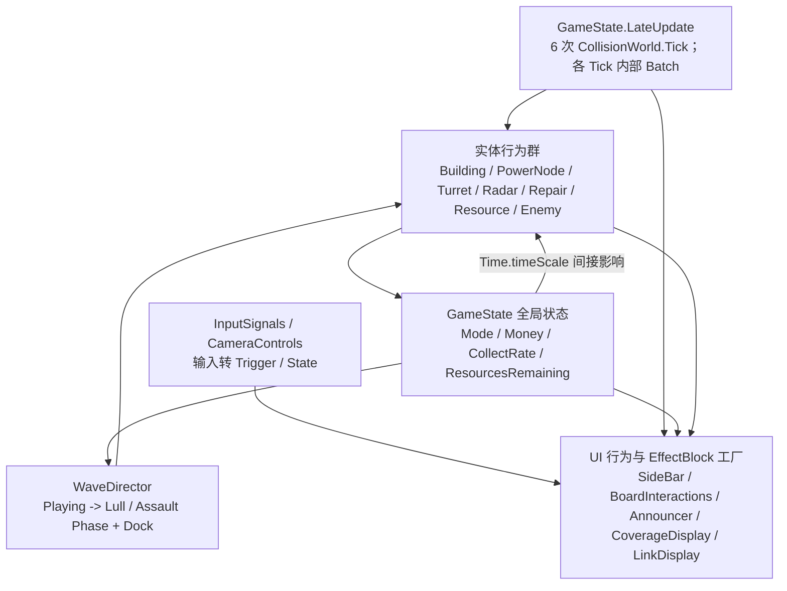

# Spoke 05_BaseDefence 架构调研

本文记录 `Adam4lexander/Spoke` 的 `Examples/05_BaseDefence` 在固定提交 [`26b102256342cbe17f5d7f3cc7c80dabde7779e6`](https://github.com/Adam4lexander/Spoke/commit/26b102256342cbe17f5d7f3cc7c80dabde7779e6) 中的架构。固定提交日期为 2026-11-21；本文不把上游 `main` 的后续变化混入该快照。

## 范围与计数口径

- 递归遍历 `Examples/05_BaseDefence/` 下的 Git blob，只计 `.cs` 和 `.md`：28 个 C# 文件与 1 个 `README.md`，共 **29 个源码与文档文件**。
- 同一目录共有 117 个 blob；其余 88 个为 63 个 `.meta`、12 个 `.mat`、12 个 `.prefab` 和 1 个 `.unity` 文件。证据为[固定提交的递归 Git tree](https://api.github.com/repos/Adam4lexander/Spoke/git/trees/26b102256342cbe17f5d7f3cc7c80dabde7779e6?recursive=1)与[范例 README](https://github.com/Adam4lexander/Spoke/blob/26b102256342cbe17f5d7f3cc7c80dabde7779e6/Examples/05_BaseDefence/README.md)。
- 下列只读命令可重取 `main` 并按相同口径计数；其输出中的 SHA 用于确认是否与本文固定提交一致。

```powershell
python -c "import json,urllib.request,collections; base='https://api.github.com/repos/Adam4lexander/Spoke'; sha=json.load(urllib.request.urlopen(base+'/commits/main'))['sha']; tree=json.load(urllib.request.urlopen(base+'/git/trees/'+sha+'?recursive=1')); files=[x['path'] for x in tree['tree'] if x['type']=='blob' and x['path'].startswith('Examples/05_BaseDefence/')]; src=[p for p in files if p.endswith(('.cs','.md'))]; print('SHA',sha); print('source+docs',len(src),dict(collections.Counter(p.rsplit('.',1)[1] for p in src))); print('all blobs',len(files)); print(*src,sep='\n')"
```

本文计数结果为：

```text
SHA 26b102256342cbe17f5d7f3cc7c80dabde7779e6
source+docs 29 {'cs': 28, 'md': 1}
all blobs 117
```

## 核心模式

1. **Spoke 树组织主要玩法行为，Unity 回调仍有明确位置**
   `Building`、`PowerNode`、`Turret`、`Repair`、`Radar`、`Resource`、`Enemy`、`Health`、`BombBlast` 等实体使用 `SpokeBehaviour`；`Pool`、`InputSignals` 等入口使用 `SpokeSingleton`，并在 `Init(EffectBuilder s)` 中声明因果关系，示例见 [Pool.cs](https://github.com/Adam4lexander/Spoke/blob/26b102256342cbe17f5d7f3cc7c80dabde7779e6/Examples/05_BaseDefence/Scripts/Pool.cs#L13-L52) 与 [InputSignals.cs](https://github.com/Adam4lexander/Spoke/blob/26b102256342cbe17f5d7f3cc7c80dabde7779e6/Examples/05_BaseDefence/Scripts/Controls/InputSignals.cs#L8-L26)。`WaveDirector` 是 `SpokeBehaviour`，由 `GameState` 的序列化引用暴露，见 [WaveDirector.cs:37](https://github.com/Adam4lexander/Spoke/blob/26b102256342cbe17f5d7f3cc7c80dabde7779e6/Examples/05_BaseDefence/Scripts/WaveDirector.cs#L37)。`GameState.LateUpdate()` 与 Gizmos 回调仍保留，见 [GameState.cs:93-102](https://github.com/Adam4lexander/Spoke/blob/26b102256342cbe17f5d7f3cc7c80dabde7779e6/Examples/05_BaseDefence/Scripts/GameState.cs#L93-L102)。

2. **嵌套 Phase 同时表达状态与资源所有权**
   [Building.cs:39-63](https://github.com/Adam4lexander/Spoke/blob/26b102256342cbe17f5d7f3cc7c80dabde7779e6/Examples/05_BaseDefence/Scripts/Units/Buildings/Building.cs#L39-L63) 在 `IsEnabled` 下划分存活和死亡子相位；存活相位注册地面碰撞体、`Building.All` 和受击行为，退出时经 `s.Use` / `OnCleanup` 清理，死亡相位处理破碎与回池。[Health.cs:35-44](https://github.com/Adam4lexander/Spoke/blob/26b102256342cbe17f5d7f3cc7c80dabde7779e6/Examples/05_BaseDefence/Scripts/Units/Health.cs#L35-L44) 在 `IsEnabled` 清理时把伤害归零，避免回池对象携带旧伤害状态。

3. **空间查询以响应式信号暴露**
   `CollisionWorld<T>` 封装二维圆形空间查询，实体通过 `AddSensor` / `AddCollider` 注册空间体，并以 `sensor.Overlaps` 响应邻近变化。[GameState.cs:93-99](https://github.com/Adam4lexander/Spoke/blob/26b102256342cbe17f5d7f3cc7c80dabde7779e6/Examples/05_BaseDefence/Scripts/GameState.cs#L93-L99) 每帧依次调用 6 个 `CollisionWorld.Tick()`；[CollisionWorld.cs:70-90](https://github.com/Adam4lexander/Spoke/blob/26b102256342cbe17f5d7f3cc7c80dabde7779e6/Examples/05_BaseDefence/Scripts/Spatial/CollisionWorld.cs#L70-L90) 显示每次 `Tick()` 在自身内部执行 `SpokeRuntime.Batch(step)`，并更新脏格与按距离排序的 `Overlaps`。

4. **分布式响应式网络承担电网连通计算**
   [PowerNode.cs:77-95](https://github.com/Adam4lexander/Spoke/blob/26b102256342cbe17f5d7f3cc7c80dabde7779e6/Examples/05_BaseDefence/Scripts/Units/Buildings/PowerNode.cs#L77-L95) 在父节点失效时清空 `parent`；[PowerNode.cs:99-132](https://github.com/Adam4lexander/Spoke/blob/26b102256342cbe17f5d7f3cc7c80dabde7779e6/Examples/05_BaseDefence/Scripts/Units/Buildings/PowerNode.cs#L99-L132) 以 `s.Memo` 沿 `s.D(n.parent)` 追溯祖先和根连接，并按覆盖、距离及防环条件选择父节点。中继失效会自动断开依赖链，新的连接仍受这些条件约束。

5. **EffectBlock 组合行为，作用域拥有临时视觉资源**
   [Turret.cs:43-87](https://github.com/Adam4lexander/Spoke/blob/26b102256342cbe17f5d7f3cc7c80dabde7779e6/Examples/05_BaseDefence/Scripts/Units/Buildings/Turret.cs#L43-L87) 拆分 `RotateToTarget`、`IdleBehaviour`、`AttackBehaviour(target)`。[CoverageDisplay.cs:39-67](https://github.com/Adam4lexander/Spoke/blob/26b102256342cbe17f5d7f3cc7c80dabde7779e6/Examples/05_BaseDefence/Scripts/UI/CoverageDisplay.cs#L39-L67) 与 [LinkDisplay.cs:42-70](https://github.com/Adam4lexander/Spoke/blob/26b102256342cbe17f5d7f3cc7c80dabde7779e6/Examples/05_BaseDefence/Scripts/UI/LinkDisplay.cs#L42-L70) 在作用域内创建临时 `GameObject`、`Mesh`、`Material`，退出时由 `OnCleanup` 销毁。

6. **Dock 管理动态身份，受守卫协程承载短寿命帧循环**
   [WaveDirector.cs:100-127](https://github.com/Adam4lexander/Spoke/blob/26b102256342cbe17f5d7f3cc7c80dabde7779e6/Examples/05_BaseDefence/Scripts/WaveDirector.cs#L100-L127) 以 `dock.Effect(enemy, ...)` 登记死亡计数，并以 `dock.Drop(enemy)` 移除敌人。[Announcer.cs:29-53](https://github.com/Adam4lexander/Spoke/blob/26b102256342cbe17f5d7f3cc7c80dabde7779e6/Examples/05_BaseDefence/Scripts/UI/Announcer.cs#L29-L53) 使用固定 `"announce"` 键替换旧播报。[SpokeExtensions.cs:16-39](https://github.com/Adam4lexander/Spoke/blob/26b102256342cbe17f5d7f3cc7c80dabde7779e6/Examples/05_BaseDefence/Scripts/SpokeExtensions.cs#L16-L39) 以 `IsEnabled` 守卫协程，并在清理时停止协程。

## 运行时数据流



| 节点或边 | 固定版本证据 |
|---|---|
| `Input` | [CameraControls.cs:43-66](https://github.com/Adam4lexander/Spoke/blob/26b102256342cbe17f5d7f3cc7c80dabde7779e6/Examples/05_BaseDefence/Scripts/Controls/CameraControls.cs#L43-L66) 把输入写入 Spoke 信号 |
| `Spatial` | [GameState.cs:32-37](https://github.com/Adam4lexander/Spoke/blob/26b102256342cbe17f5d7f3cc7c80dabde7779e6/Examples/05_BaseDefence/Scripts/GameState.cs#L32-L37)、[GameState.cs:93-99](https://github.com/Adam4lexander/Spoke/blob/26b102256342cbe17f5d7f3cc7c80dabde7779e6/Examples/05_BaseDefence/Scripts/GameState.cs#L93-L99)、[CollisionWorld.cs:70-90](https://github.com/Adam4lexander/Spoke/blob/26b102256342cbe17f5d7f3cc7c80dabde7779e6/Examples/05_BaseDefence/Scripts/Spatial/CollisionWorld.cs#L70-L90) |
| `State` | [GameState.cs:25-28](https://github.com/Adam4lexander/Spoke/blob/26b102256342cbe17f5d7f3cc7c80dabde7779e6/Examples/05_BaseDefence/Scripts/GameState.cs#L25-L28) 声明图中四个状态 |
| `Director` | [WaveDirector.cs:71-77](https://github.com/Adam4lexander/Spoke/blob/26b102256342cbe17f5d7f3cc7c80dabde7779e6/Examples/05_BaseDefence/Scripts/WaveDirector.cs#L71-L77)、[WaveDirector.cs:100-127](https://github.com/Adam4lexander/Spoke/blob/26b102256342cbe17f5d7f3cc7c80dabde7779e6/Examples/05_BaseDefence/Scripts/WaveDirector.cs#L100-L127) |
| `Input → UI` | [BoardInteractions.cs:109-116](https://github.com/Adam4lexander/Spoke/blob/26b102256342cbe17f5d7f3cc7c80dabde7779e6/Examples/05_BaseDefence/Scripts/UI/BoardInteractions.cs#L109-L116) 订阅点击信号 |
| `Spatial → Entities` | [Turret.cs:46-52](https://github.com/Adam4lexander/Spoke/blob/26b102256342cbe17f5d7f3cc7c80dabde7779e6/Examples/05_BaseDefence/Scripts/Units/Buildings/Turret.cs#L46-L52) 注册空间体并读取 `Overlaps` |
| `Spatial → UI` | [BoardInteractions.cs:59-68](https://github.com/Adam4lexander/Spoke/blob/26b102256342cbe17f5d7f3cc7c80dabde7779e6/Examples/05_BaseDefence/Scripts/UI/BoardInteractions.cs#L59-L68) 以空间传感器计算悬停 |
| `State → Director` | [WaveDirector.cs:71-77](https://github.com/Adam4lexander/Spoke/blob/26b102256342cbe17f5d7f3cc7c80dabde7779e6/Examples/05_BaseDefence/Scripts/WaveDirector.cs#L71-L77) 读取 `GameState.Mode` |
| `State → Entities` | [GameState.cs:75-80](https://github.com/Adam4lexander/Spoke/blob/26b102256342cbe17f5d7f3cc7c80dabde7779e6/Examples/05_BaseDefence/Scripts/GameState.cs#L75-L80) 通过 `Time.timeScale` 间接影响实体仿真 |
| `State → UI` | [SideBar.cs:37-44](https://github.com/Adam4lexander/Spoke/blob/26b102256342cbe17f5d7f3cc7c80dabde7779e6/Examples/05_BaseDefence/Scripts/UI/SideBar.cs#L37-L44)、[SideBar.cs:81-92](https://github.com/Adam4lexander/Spoke/blob/26b102256342cbe17f5d7f3cc7c80dabde7779e6/Examples/05_BaseDefence/Scripts/UI/SideBar.cs#L81-L92) 读取模式、货币和资源状态 |
| `Director → Entities` | [WaveDirector.cs:109-123](https://github.com/Adam4lexander/Spoke/blob/26b102256342cbe17f5d7f3cc7c80dabde7779e6/Examples/05_BaseDefence/Scripts/WaveDirector.cs#L109-L123) 生成敌人并登记其死亡行为 |
| `Entities → State` | [Resource.cs:44-45](https://github.com/Adam4lexander/Spoke/blob/26b102256342cbe17f5d7f3cc7c80dabde7779e6/Examples/05_BaseDefence/Scripts/Units/Buildings/Resource.cs#L44-L45)、[Resource.cs:79-87](https://github.com/Adam4lexander/Spoke/blob/26b102256342cbe17f5d7f3cc7c80dabde7779e6/Examples/05_BaseDefence/Scripts/Units/Buildings/Resource.cs#L79-L87) 更新资源数、采集速率和货币 |
| `Entities → UI` | [BoardInteractions.cs:75-84](https://github.com/Adam4lexander/Spoke/blob/26b102256342cbe17f5d7f3cc7c80dabde7779e6/Examples/05_BaseDefence/Scripts/UI/BoardInteractions.cs#L75-L84) 读取实体悬停信息并驱动覆盖与电网显示 |

## 与 se-fish 的边界差异

- **状态写入边界不同**：范例 UI 直接读写 `GameState`，例如 [SideBar.cs:60](https://github.com/Adam4lexander/Spoke/blob/26b102256342cbe17f5d7f3cc7c80dabde7779e6/Examples/05_BaseDefence/Scripts/UI/SideBar.cs#L60) 直接设置 `Mode`。se-fish 的客户端上行权威操作经 [client/main.lua](../../client/main.lua) 的 `FireServer` 发送，服务端在 [server_runtime.lua](../../server/world_host/server_runtime.lua) 的 RemoteEvent 路由与 [player_tree.lua](../../server/world_host/player_tree.lua) 的 `dispatch_action` 中处理；下行快照由 [client_store.lua](../../client/store/client_store.lua) 收敛。
- **单位生命周期合同不同**：范例使用 `Pool.Spawn` / `Pool.Despawn`；se-fish 的 `spoke_eggy` 把树生命周期绑定到 `Unit.Destroying`，且 `is_alive` 不覆盖关局，见 [ADR-0022](../../docs/adr/0022-introduce-spoke-runtime.md)。
- **事务与离场边界不同**：se-fish 使用 `SpokeRuntime.batch` 组织原子状态更新，并以 `session_alive=false`、树 dispose、宿主持久化排空构成离场三步协议，见 [ADR-0032](../../docs/adr/0032-spoke-native-lifecycle-architecture.md) 与 [server_runtime.lua](../../server/world_host/server_runtime.lua)。

## 复核记录

- 上游复核时间：2026-11-27（Asia/Shanghai）。
- 固定上游提交：[26b102256342cbe17f5d7f3cc7c80dabde7779e6](https://github.com/Adam4lexander/Spoke/commit/26b102256342cbe17f5d7f3cc7c80dabde7779e6)。
- 本仓拆分基线：[de5f0178fd417605c4c310a8168c320396a7938f](https://github.com/qinyuanj/se-fish/commit/de5f0178fd417605c4c310a8168c320396a7938f)。
- 本文所有上游代码链接均含完整提交 SHA；本仓对照仅引用当前代码路径与已接受 ADR。
